# Joints

<!-- Written by crates/ui-egui/tests/guide.rs from the app itself. Don't edit it by hand:
     change the app and run `cargo test -p woodsketch-ui-egui --test guide`, which rewrites it. -->

Select exactly two parts and the **Joinery** panel appears in the tray. It offers only the
joints that suit how those two parts actually sit, so if the one you want isn't there, move
the parts to where that joint needs them.

Making a joint cuts **both** parts in one undo step and records it, so **Change** re-opens its
sizes and **Remove** rebuilds the parts without it. Parts that aren't square to each other get
angled joints instead -- an angled mortise and tenon, or a housing.

Why you would pick one over another is [Choosing a joint](../concepts/choosing-a-joint.md).

| Joint | How the parts must sit | What it is |
|---|---|---|
| **Dado** | Butted: a shelf's end against the side's face | A square trench across the grain, for a shelf let into a case side. |
| **Groove** | Butted | A trench along the grain. A panel in a groove floats, so it is the answer to wood movement in a frame. |
| **Rabbet** | Butted, at the end of the other part | A step along an edge or an end, for a back or a cabinet bottom. |
| **Notch** | Overlapping | A corner cut out of a part so another passes through it. |
| **Mortise** | Overlapping | A recess sized for whatever sits in it. |
| **Mortise and tenon** | Butted | The frame joint: a tenon on one part into a mortise in the other. Haunched where it meets a groove, through where you want it seen. |
| **Dovetails** | Butted at a corner | Tails and pins sloped at 1:8, locked against being pulled apart. Drawer fronts, carcase corners. |
| **Box joint** | Two ends meeting at a corner | Square fingers, cut on a table saw. Nearly a dovetail's strength for a fraction of the setup. |
| **Half-lap** | Crossing, each overlapping the other | Both parts cut to half their thickness so they finish flush where they cross. |
| **Dowels** | Butted | Round pegs in matching holes. Cheap to get into, and sound. |
| **Biscuits** | Butted | Compressed beech ovals in matching slots: alignment, and enough strength for face frames and casework. |
| **Loose tenons** | Butted | A separate tenon in a slot in both parts -- a mortise and tenon in a fraction of the time, given the machine. Slots go two thirds of the way into a face and the rest into the end, rounded to whole millimetres, and will take your machine's own depth stops. |
| **Spline** | Butted | A thin strip in a groove in both parts: mitres, edge joints, and a decorative line. |
| **Pocket screws** | Butted | A screw at 15 degrees through a bored pocket stepping to a pilot hole. No clamps, no drying time; hide them. |

## Which parts get cut

Some joints are a recess in one part that the other is simply made to fit: a shelf let into a
dado grows to fill it, so it has no cut of its own to mark out. The rest cut both parts, and
both get the cut on their build sheet.

- **One part cut, the other sized to fit:** Dado, Groove, Rabbet, Notch, Mortise.
- **Both parts cut:** Mortise and tenon, Dovetails, Box joint, Half-lap, Dowels, Biscuits, Loose tenons, Spline, Pocket screws.

## What they look like

Every picture here is two boards and one joint, built from a recipe in
`docs/guide/recipes/` by the same joinery the app uses. Change how a dovetail is cut and these
change with it.

<figure class="ws-shot">

<figcaption>Dado</figcaption>
</figure>
<figure class="ws-shot">
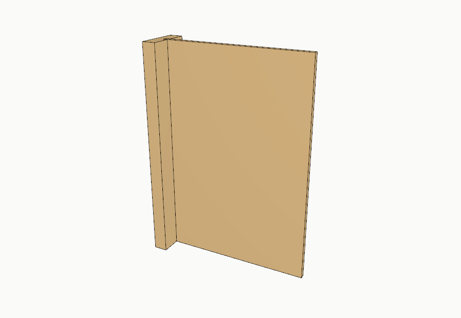
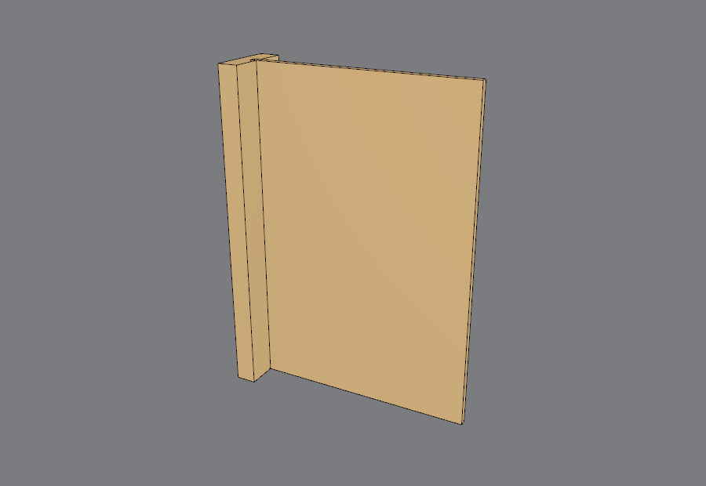
<figcaption>Groove</figcaption>
</figure>
<figure class="ws-shot">
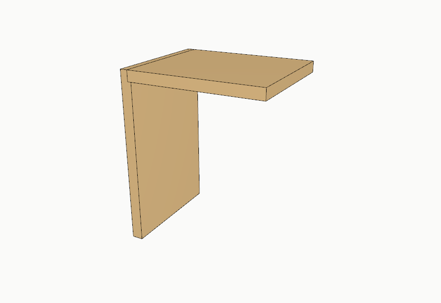
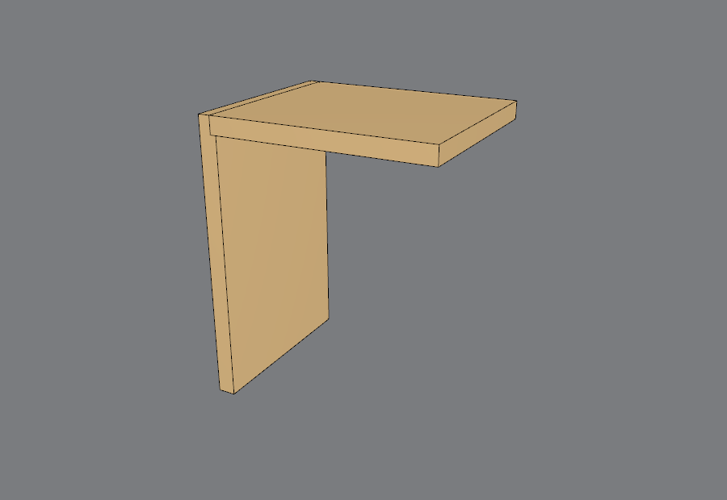
<figcaption>Rabbet</figcaption>
</figure>
<figure class="ws-shot">
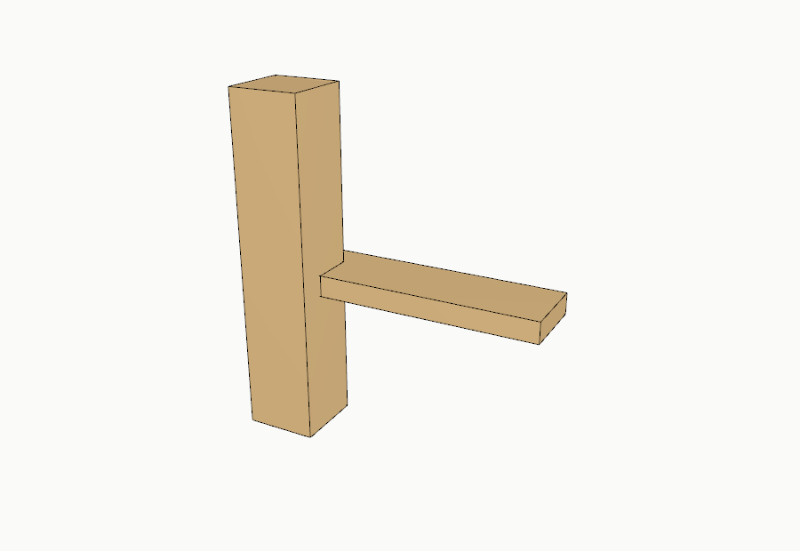
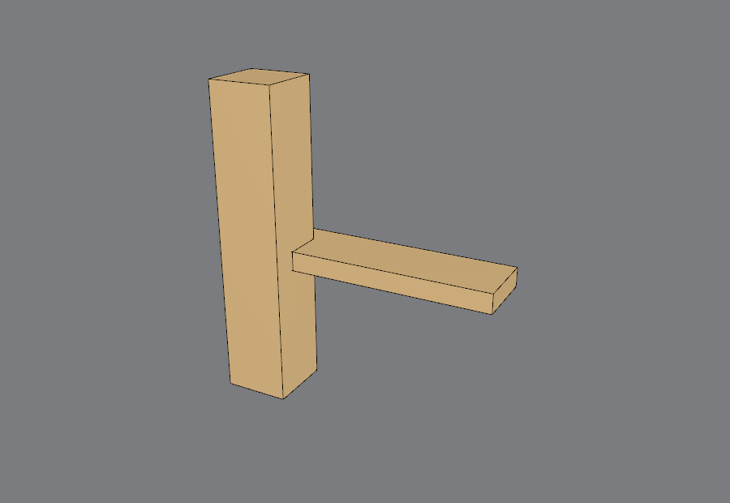
<figcaption>Notch</figcaption>
</figure>
<figure class="ws-shot">

<figcaption>Mortise</figcaption>
</figure>
<figure class="ws-shot">
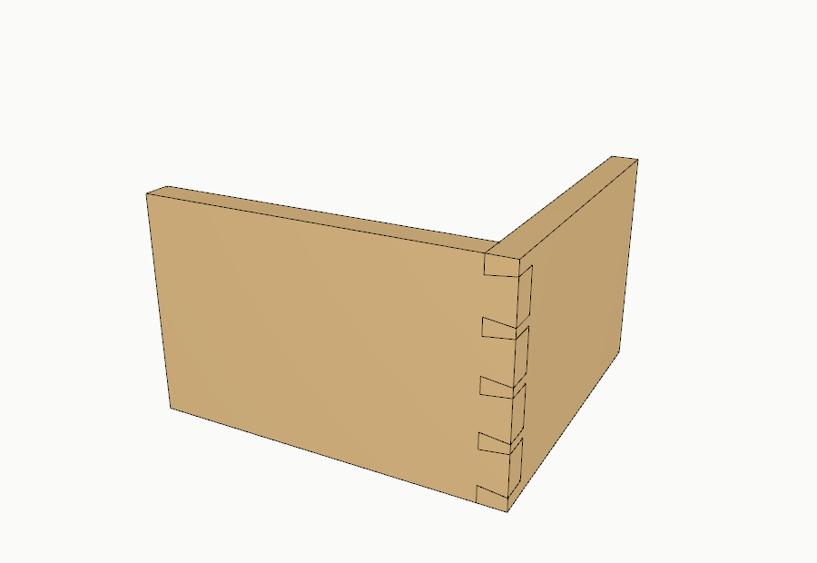

<figcaption>Dovetails</figcaption>
</figure>
<figure class="ws-shot">

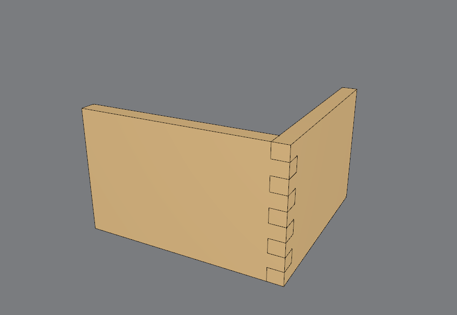
<figcaption>Box joint</figcaption>
</figure>
<figure class="ws-shot">
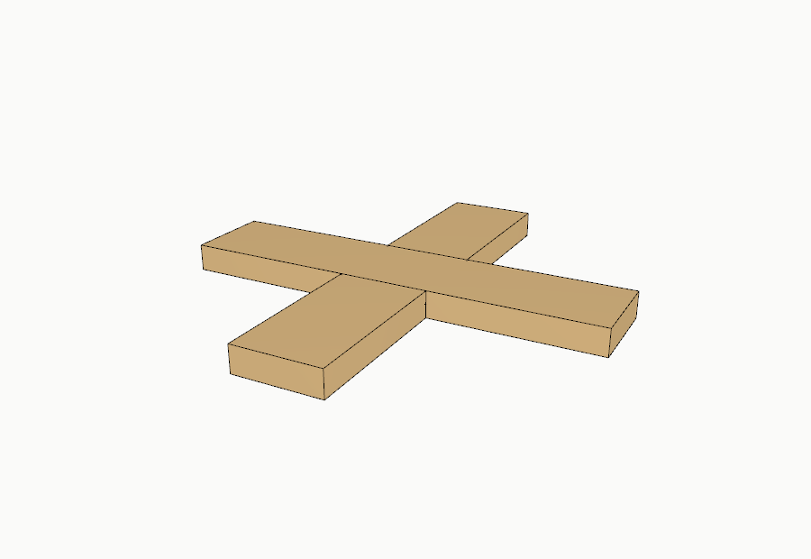
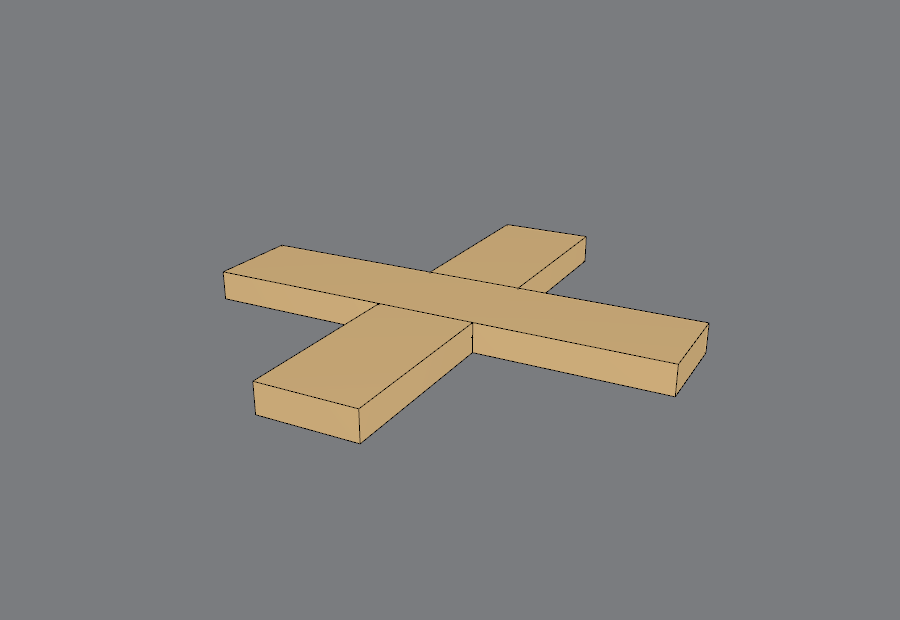
<figcaption>Half-lap</figcaption>
</figure>
<figure class="ws-shot">

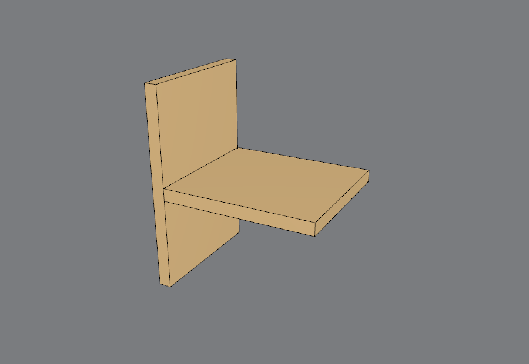
<figcaption>Dowels</figcaption>
</figure>
<figure class="ws-shot">

<figcaption>Biscuits</figcaption>
</figure>
<figure class="ws-shot">

<figcaption>Loose tenons</figcaption>
</figure>
<figure class="ws-shot">

<figcaption>Spline</figcaption>
</figure>
<figure class="ws-shot">
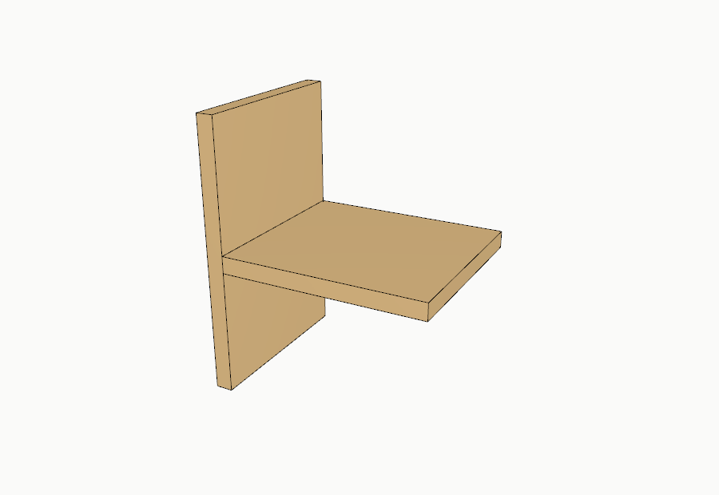

<figcaption>Pocket screws</figcaption>
</figure>

