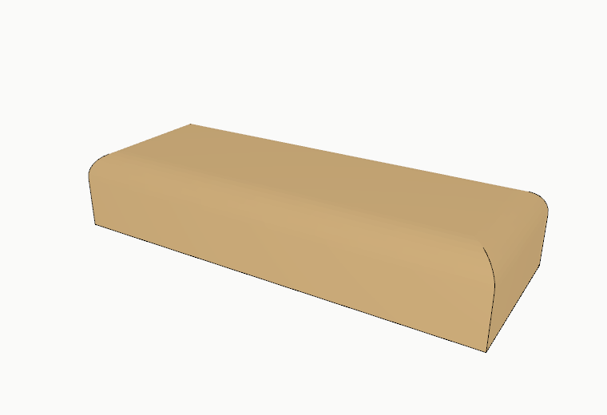
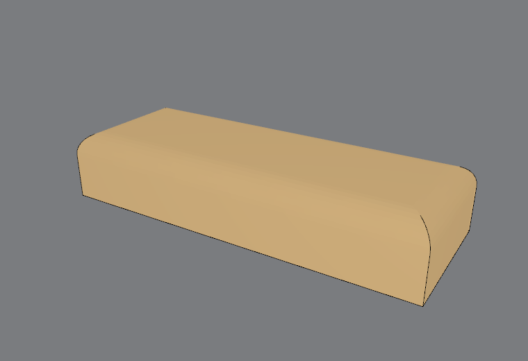
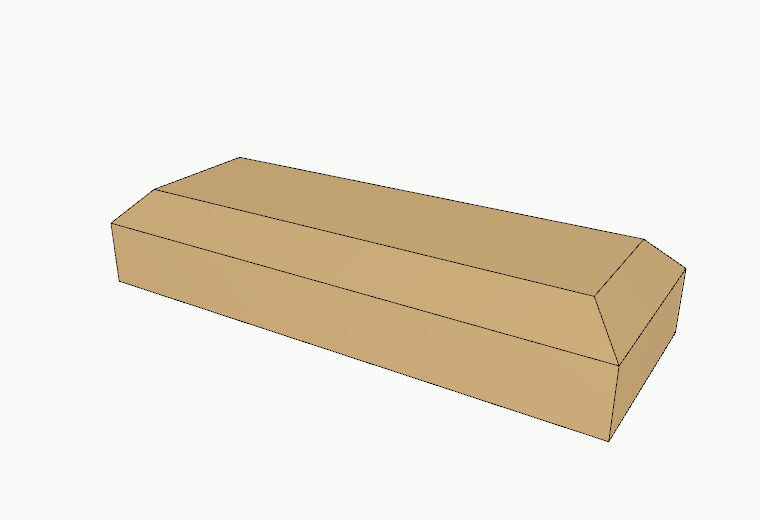
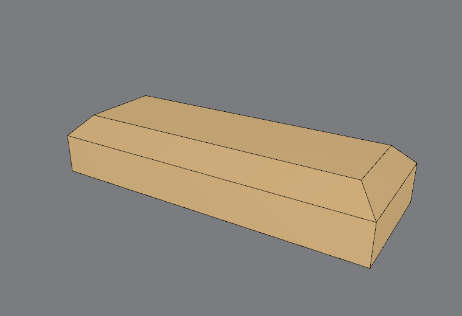

# Edge profiles

<!-- Written by crates/ui-egui/tests/guide.rs from the app itself. Don't edit it by hand:
     change the app and run `cargo test -p woodsketch-ui-egui --test guide`, which rewrites it. -->

Select one part and the **Edge profile** panel appears in the tray. Pick the edges by where
they face -- Top, Front, and so on -- choose a profile and a size, and the part's geometry is
rebuilt with it, in one undo step.

Profiles are recorded with the drawing, so they appear as a step on the part's build sheet and
can be taken off again. Running a profile around a face makes stacked rings with mitered
corners; running it along an edge extrudes the shape the length of the part.

| Profile | What it looks like |
|---|---|
| **Roundover** | A quarter circle, convex. The everyday edge treatment: takes the sharpness off and wears well. |
| **Chamfer** | A flat bevel straight across the corner. Crisp, and the one you can cut with a hand plane. |
| **Cove** | A quarter circle, concave -- scooped into the corner. Under a tabletop edge, or as part of a moulding. |
| **Ogee** | An S curve: concave near one face, convex near the other. The classic traditional moulding. |

## What they look like

A 1 1/2" block with a 1/2" profile run all round its top face, the way a table edge is
treated. Built from the recipes in `docs/guide/recipes/profiles/`, so the shape is the one the
app cuts rather than a drawing of it.

<figure class="ws-shot">

<figcaption>Roundover</figcaption>
</figure>
<figure class="ws-shot">

<figcaption>Chamfer</figcaption>
</figure>
<figure class="ws-shot">

<figcaption>Cove</figcaption>
</figure>
<figure class="ws-shot">

<figcaption>Ogee</figcaption>
</figure>

