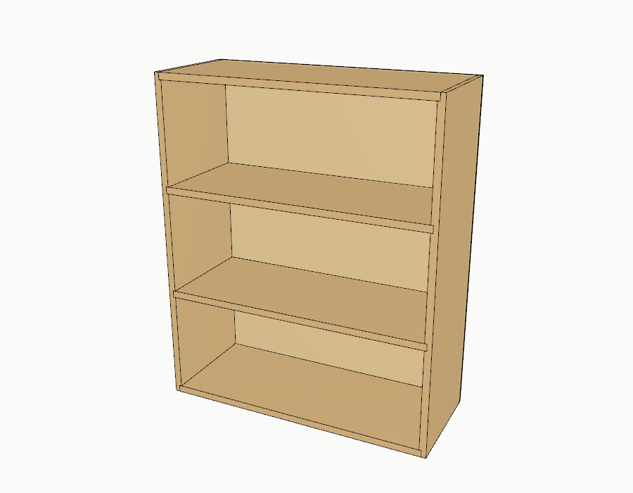
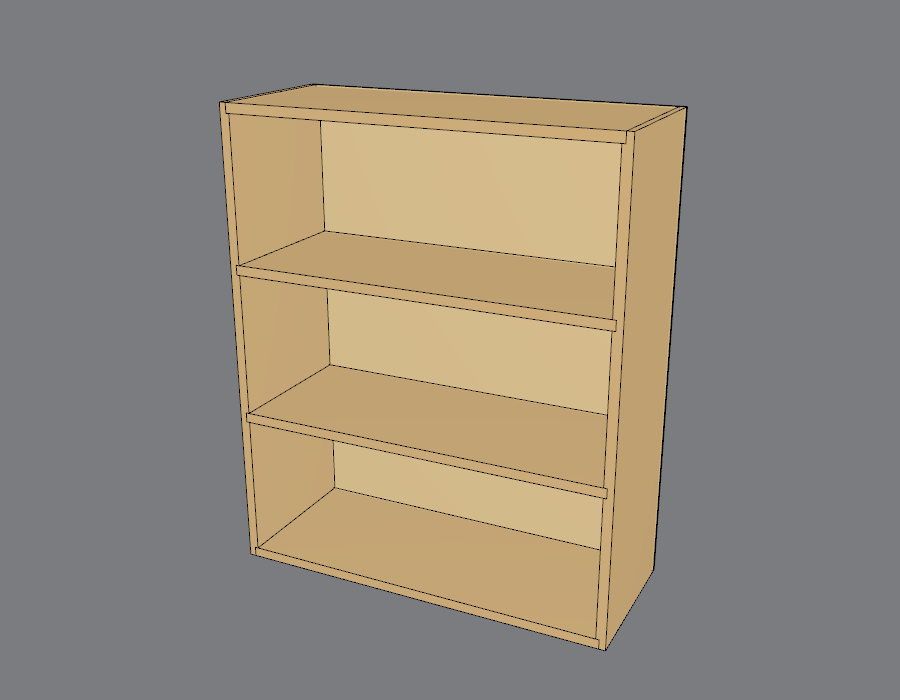
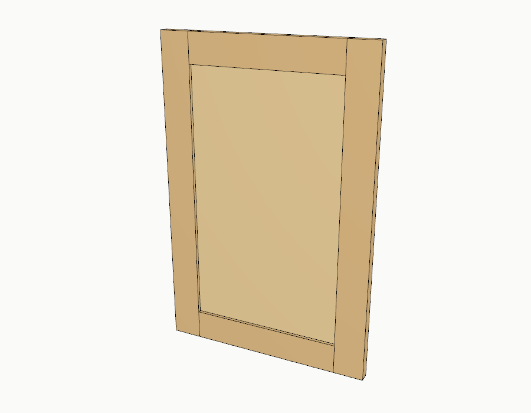
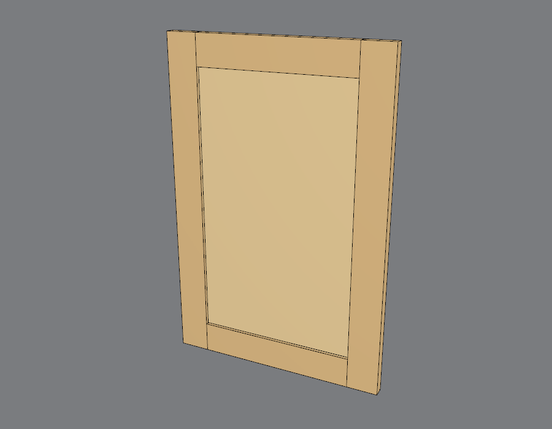
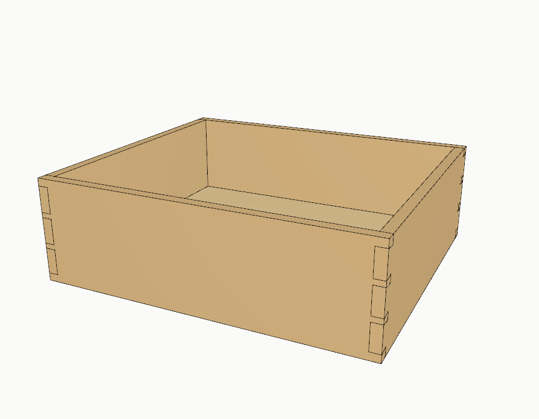
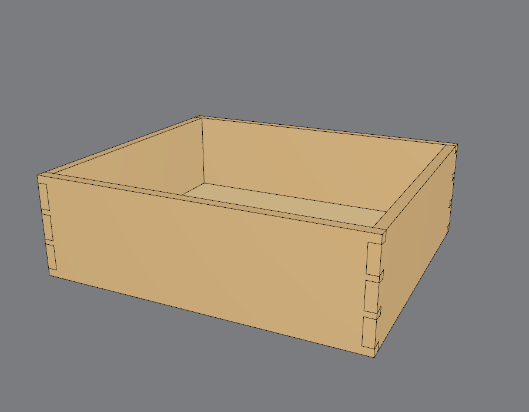
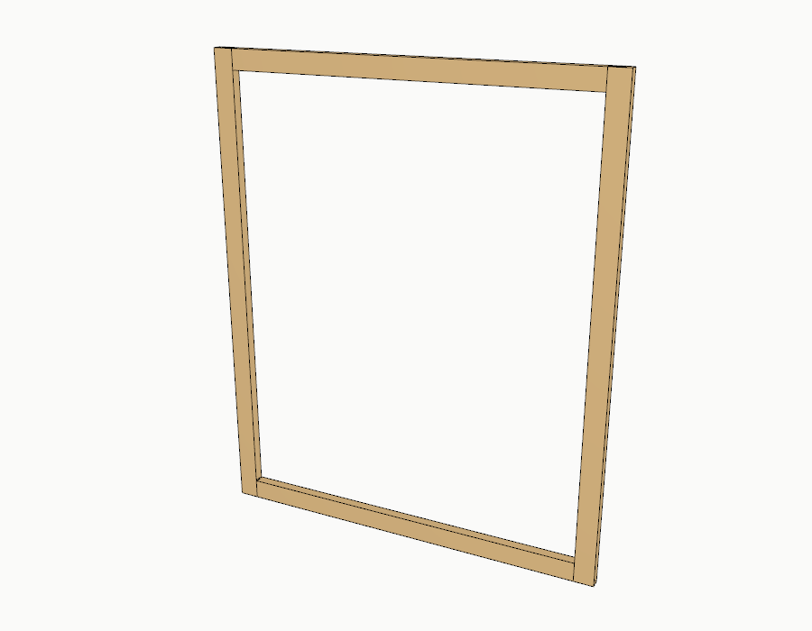
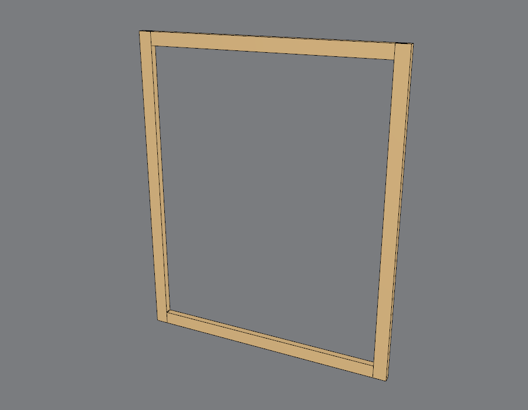
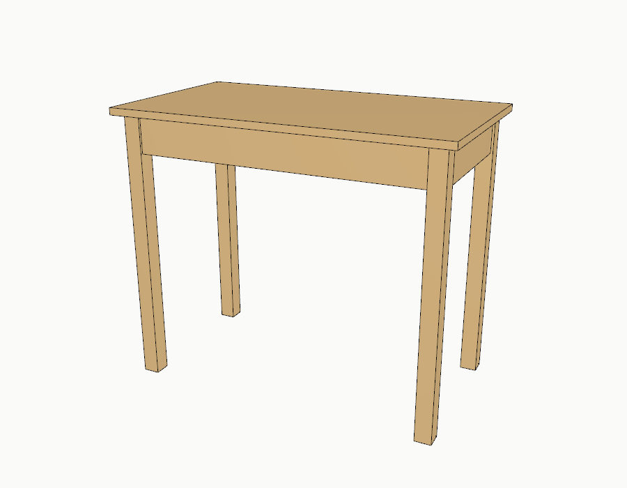
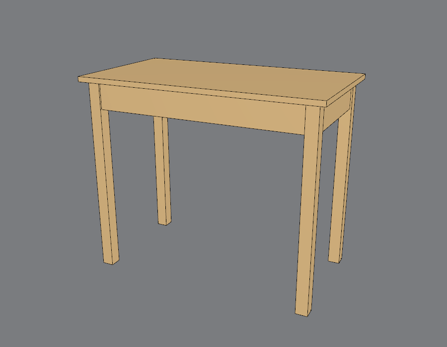

# Templates

<!-- Written by crates/ui-egui/tests/guide.rs from the app itself. Don't edit it by hand:
     change the app and run `cargo test -p woodsketch-ui-egui --test guide`, which rewrites it. -->

The **Templates** panel in the tray builds a whole piece from a few sizes and a joint choice,
rather than board by board. A new one is **carried to where you click** -- it is built at the
origin and handed to the Move tool, so `Esc` undoes the whole thing and the status bar tells
you to click to put it down.

The sizes stay on the piece. Select it and the **Sizes** panel re-opens them, so changing a
cabinet's height rebuilds it at that height instead of stretching it. Edit one by hand and it
will refuse to rebuild until you tell it twice, because it can no longer be sure what it would
be throwing away.

| Template | What it builds |
|---|---|
| **Cabinet** | A carcase: sides, top, bottom, back and shelves, with the joints you pick. Each opening between shelves can be left open, or filled with a drawer (a box on slides, a front and a pull) or doors (a pair over 24 inches wide, slab or frame-and-panel, on concealed hinges), set overlay or inset. |
| **Door** | A door on its own, to a size you give, for hanging on something that isn't a WoodSketch cabinet. Slab, or frame-and-panel with stub tenons and a floating panel. |
| **Drawer** | A drawer box to a size you give, on the longest side-mount slides that fit, with the front and the pull. |
| **Face frame** | Stiles and rails to the opening you give, with middle rails where you want them. |
| **Table** | A top, four legs and aprons, joined to the legs. |

## The joints they offer

- **Carcases** (a cabinet's case): **Dados and rabbets**, **Biscuits**, **Pocket screws**, **Butt joints**.
- **Drawers** (the box's corners): **Dovetails**, **Box joints**, **Rabbets**.
- **Frames** (a door, a face frame, a table's aprons): **Mortise and tenon**, **Pocket screws**, **Dowels**.

What each of those is, and when to choose it, is in [Joints](joints.md) and
[Choosing a joint](../concepts/choosing-a-joint.md).

## What they build

Each one at its own starting sizes, before you change a number. These are built by the same
code the Templates panel runs, from the recipes in `docs/guide/recipes/templates/`.

<figure class="ws-shot">

<figcaption>Cabinet</figcaption>
</figure>
<figure class="ws-shot">

<figcaption>Door</figcaption>
</figure>
<figure class="ws-shot">

<figcaption>Drawer</figcaption>
</figure>
<figure class="ws-shot">

<figcaption>Face frame</figcaption>
</figure>
<figure class="ws-shot">

<figcaption>Table</figcaption>
</figure>

