# The tray panels

<!-- Written by crates/ui-egui/tests/guide.rs from the app itself. Don't edit it by hand:
     change the app and run `cargo test -p woodsketch-ui-egui --test guide`, which rewrites it. -->

The strip down the right-hand side. Each panel is folded by its header, closed by the ✕,
and opened again from **Window > Default Tray** -- which also forces one always on or
always off, where the usual behaviour is to appear when it has something to work on.

The `?` on a panel's header opens its section here.

## Board

<figure class="ws-panel">
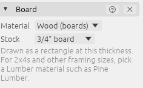
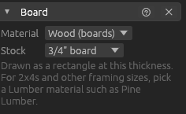
</figure>

The stock the Board tool draws in.

**Material** lists the drawing's own woods first, then the library's -- picking one from the library adds it to the drawing. **Stock** is the standard size that material comes in: a thickness for boards and sheets, a section like 2x4 for lumber. Lumber also chooses whether it lies flat or on edge.

## Entity Info

<figure class="ws-panel">
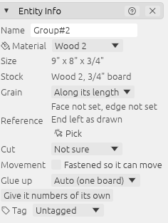
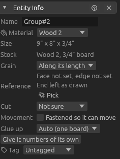
</figure>

Everything one part knows about itself.

**Name** is what the cut list, the diagrams and the build sheets will call it, and parts sharing a name, material and size are counted together. **Material**, **Size** and **Stock** say what it is cut from. **Grain** runs along the part's longest side unless you say otherwise, and decides both which way it moves and how it is laid out on the stock. **Reference** picks the face, edge and end every cut on the build sheet is measured from -- **Pick** then takes the surface you click. **Cut** is flat-sawn or quartersawn, which chooses how far it moves; unset means flat-sawn, the worse case. **Movement** marks a part free to move, for a top on buttons or slotted screws. **Glue up** splits a part too wide to buy into boards. **Tag** puts it on a tag.

## Joinery

<figure class="ws-panel">
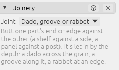
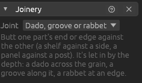
</figure>

The joints two selected parts can have, and the sizes to cut them at.

> **Needs a selection.** Select two parts that touch, to joint them.

The picker offers only what suits how the two parts actually sit, and says how to place them when none fits. Below it are that joint's own sizes -- a dado's depth, a tenon's length and thickness, a dovetail's pins, how many dowels -- and a **fit** allowance where the joint has one. **Make** cuts both parts in one undo step; afterwards **Change** re-opens the sizes and **Remove** rebuilds the parts without the joint.

## Sizes

<figure class="ws-panel">
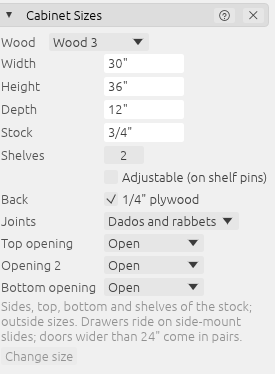
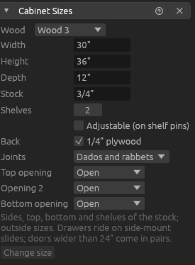
</figure>

The numbers a template or parametric component was built from.

> **Needs a selection.** Select something made from a template or built from a recipe, to change its sizes.

Change one and the piece is **built again** at that size rather than stretched, so its joints, shelves and openings are remade to suit. A cabinet offers its width, height, depth, stock thickness, shelves, back, case joints and what fills each opening; a table its top and leg sizes. A component you made parametric shows the numbers you gave it. **Change size** applies them.

## Edge Profile

<figure class="ws-panel">
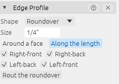
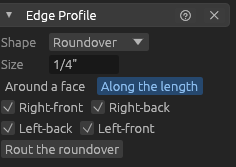
</figure>

A moulded edge on the selected part.

> **Needs a selection.** Select one part, to profile its edges.

Pick the edges by **where they face** -- Top, Front, and so on -- then the **profile** and its **size**. The part's geometry is rebuilt with it in one undo step, and the profile is recorded, so it appears as a step on the build sheet and can be taken off again.

## Templates

<figure class="ws-panel">
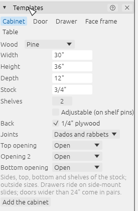
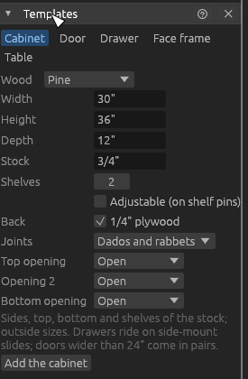
</figure>

A whole cabinet, door, drawer, face frame or table from a few sizes.

Choose the kind, set its sizes and joints, and the piece is **carried on the cursor** until you click to put it down -- `Esc` throws the whole thing away. It starts folded, because it is something you go looking for rather than read while working.

## Materials

<figure class="ws-panel">
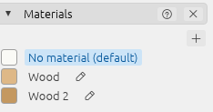
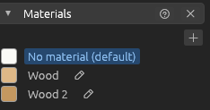
</figure>

The drawing's materials, and the library to add from.

Click one to paint with it. The **+** adds from the library or makes a new one. The editor below sets the name and colour, and the things cut lists need: the **type** (solid wood, sheet good, lumber, hardware or other), whether it has **grain**, and the **stock sizes** it is sold in, which override the drawing's defaults for that material. Solid wood and lumber also carry how far the species moves, which *Moves like* can borrow from a species you name.

## Tags

<figure class="ws-panel">
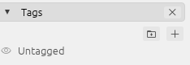
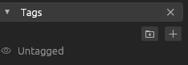
</figure>

Tags and tag folders, and what is hidden.

Tags go on groups and components only, never on loose geometry. Hiding a tag drops its parts out of the drawing entirely -- not drawn, not picked, not snapped to, not in the cut list. Rows fold into **folders**; drag a row onto a folder to move it, or onto Untagged to bring it back to the top. A tag shows only if it and every folder around it are showing.

## Outliner

<figure class="ws-panel">
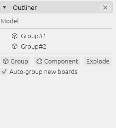
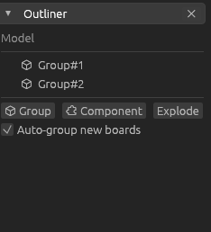
</figure>

The whole drawing as a tree.

Groups and components nested as they really are. Clicking a part opens the group it is in and selects it, which is the quickest way into something buried. Parts still needing a material are flagged here.
